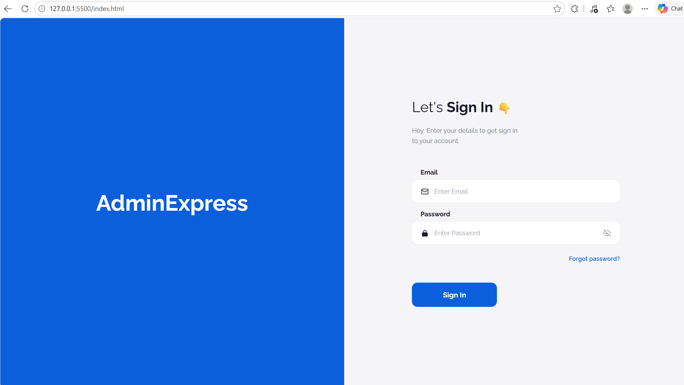
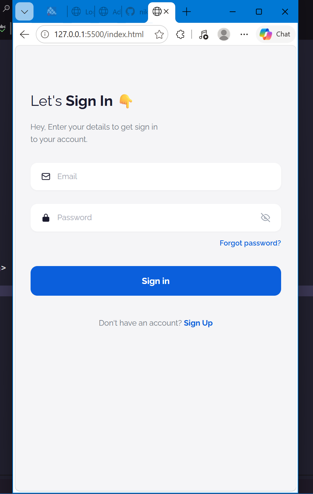

# AdminExpress · Login Responsive

Pantalla de inicio de sesión **responsive** hecha con **HTML, CSS y JavaScript puro**, sin frameworks. El diseño cambia de forma entre escritorio y móvil: en escritorio muestra un panel de marca a la izquierda y el formulario a la derecha; en móvil solo queda el formulario, ocupando todo el ancho.

---

##  Vista previa

| Escritorio | Móvil |
|:---:|:---:|
|  |  |

**Demo en vivo:** https://nikinicole04.github.io/LoginResponsive/

---


##  Estructura del proyecto

```
LoginResponsive/
├── index.html        # Página de login (estructura HTML)
├── css/
│   └── style.css     # Estilos y media queries
├── js/
│   └── script.js     # Mostrar contraseña y placeholders responsive
├── docs/             # Capturas usadas en este README
│   ├── desktop.png
│   └── mobile.png
└── README.md
```

---

##  Autor Nicole Yépez